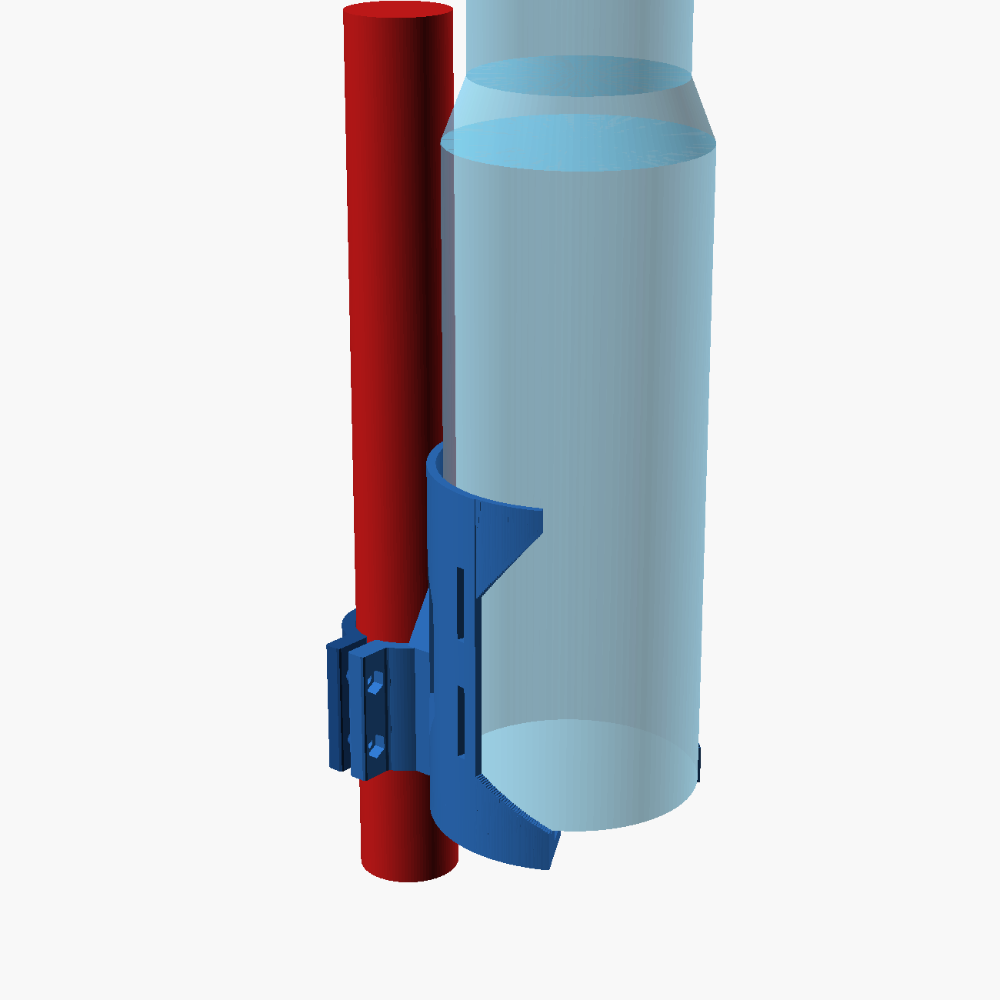
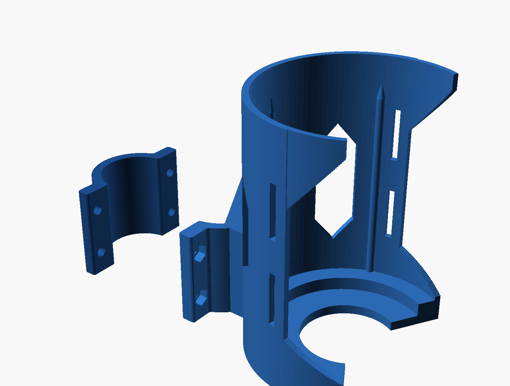
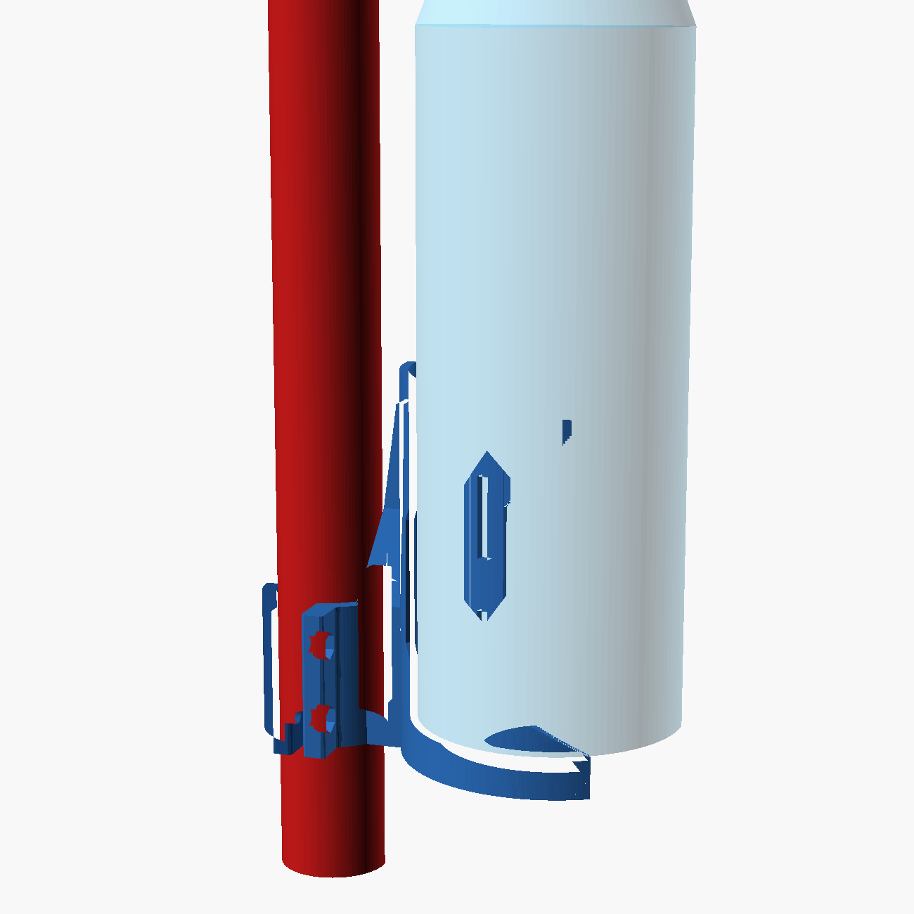
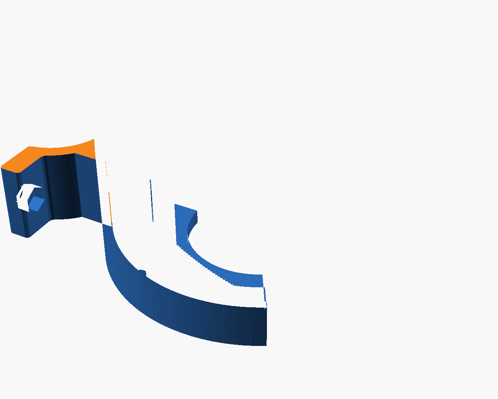

# Clamp-on bottle cage — 38 mm tube, big bottles

A bolt-on cage for a bike frame with no bottle bosses. Two printed halves
clamp around a 38 mm tube. Built around the **Owala FreeSip 40 oz**, and sized
so it also takes a standard bike bottle at the other end of the range.

Prints in PETG with **no supports**, oriented exactly as the STLs are exported.



| printed parts | section | terraced floor |
|---|---|---|
|  |  |  |

## How it handles different bottles

Three things do the work, and which one matters depends on the bottle:

1. **A two-level floor.** A base up to Ø78 drops into an inner pocket and is
   held there by a 7 mm wall — that's a standard bike bottle, positively
   located with no strap needed at the base. Anything bigger sits on the main
   floor, on a 9 mm wide ledge, located by the ribs above it.
2. **Three internal ribs** closing the Ø96.5 bore to **Ø93.5**. The Owala 40 oz
   sits in that with about 1 mm a side.
3. **A sprung top collar** with an 86.7 mm mouth. Bottles from about Ø89 up
   snap past it and are held without a strap. Smaller ones pass straight
   through, which is what the strap slots are for.

| bottle | Ø | base sits | side entry | top held by |
|---|---|---|---|---|
| standard bike bottle | 73 | inner pocket, located | 23 mm clear | strap |
| Owala FreeSip 32 oz | 87.1 | main floor | 9 mm clear | strap |
| Hydro Flask 32 oz | ~87 | main floor | 9 mm clear | strap |
| Nalgene 32 oz | ~90 | main floor | 6 mm clear | collar, 1.6 mm/side |
| **Owala FreeSip 40 oz** | **91.4** | **main floor** | **5 mm clear** | **collar, 2.3 mm/side** |
| largest that fits | 93.5 | main floor | 3 mm clear | collar, 3.4 mm/side |

## What's in here

| File | What it is |
|---|---|
| `bottle_cage_38.scad` | the parametric source — every dimension lives here |
| `stl/bottle_cage_38mm_testring.stl` | **print this first** — 14 mm slice of both clamp halves, ~20 min |
| `stl/bottle_cage_38mm_cage.stl` | main body: front clamp half + cage |
| `stl/bottle_cage_38mm_backplate.stl` | rear clamp half |
| `stl/bottle_cage_38mm_adapter.stl` | alternative: clamp + standard 64 mm bottle bosses |

You need `cage` + `backplate`, or `adapter` + `backplate`. Not both. The
adapter only makes sense for normal-sized bottles — no shop-bought cage takes
an Owala.

## Hardware

- 4 × **M5 × 25 mm** socket head cap screw (stainless)
- 4 × **M5 nyloc nut** — press into the hex pockets in the lugs
- 4 × M5 washer under the bolt heads
- A ~55 mm wide strip cut from an old inner tube, as a shim
- **1 × 25 mm wide strap, 350–400 mm long** — a Velcro cinch strap is easiest.
  Webbing with a side-release buckle or a shock cord also works. The slots are
  27.5 × 3.6 mm, at two heights.

## Key dimensions

| | |
|---|---|
| Clamp bore | Ø38.8 mm (Ø38.0 tube + shim) |
| Clamp band | 50 mm of straight tube |
| Total tube length needed | ~135 mm clear |
| Bottle bore / ribs / inner pocket | Ø96.5 / Ø93.5 / Ø78 |
| Cage height | 132 mm |
| Stick-out from tube surface | 112 mm |
| Strap slots | 2 pairs, at 48 mm and 92 mm up |
| Cage part | 104 × 103 × 132 mm, 139 cm³ |
| Backplate | 22 × 70 × 50 mm, 23 cm³ |

## Print settings (Bambu Studio, PETG, 0.4 nozzle)

- **Orientation: leave it alone.** The STLs are oriented so the clamp's hoop
  load and the collar's spring action are both in-plane, not pulling layers
  apart.
- **Supports: none.** The largest unsupported downward face anywhere on the
  part is 11 mm² — a bolt hole or a strap slot bridge. The sloped collar
  underside is a 0.68 mm micro-staircase at ~50°.
- Layer height **0.2 mm**
- **4 wall loops** (the 3.2 mm cage wall then prints fully solid)
- Top/bottom **5 layers**
- **Infill 30 % gyroid.** This one matters more than usual — the clamp band,
  the web and the floor are the load path for a heavy bottle.
- Cooling: PETG profile default (low). More cooling = weaker layer bonding.
- **Glue stick on the plate.** PETG bonds hard to bare PEI and can tear the
  coating off.
- Dry the filament if the spool has been open a while.

Cage + backplate is roughly 140–160 g and somewhere in the 10–13 hour range at
0.2 mm — estimate only, the slicer will tell you properly.

## Assembly

1. Print the **test ring** and check it on the tube. 14 mm slice of the real
   clamp, ~20 minutes. Cheap insurance against a mis-measured or slightly
   ovalised tube before you commit to a 12 hour print.
2. Print the cage and backplate.
3. Press an M5 nut into each of the four hex pockets. 8.4 mm across flats —
   snug. A bolt pulled through from the back seats them if they're tight.
4. Wrap one layer of inner-tube rubber around the tube where the clamp goes.
   It protects the paint, takes up slop, and is most of what stops the cage
   rotating under load. With this much weight it isn't optional.
5. Cage on the front, backplate on the back, four bolts in from the back with
   washers. Tighten in a cross pattern — the gap between the halves should
   stay roughly equal top and bottom.
6. **Snug plus about a quarter turn, ~2–3 N·m.** These are plastic lugs; you
   will crush them long before an M5 bolt complains.
7. Thread the strap through whichever slot pair suits the bottle.
8. **Re-check the bolts after the first ride, then again after a week.** PETG
   creeps, and this is a heavy load.

Loading a bottle: push it in sideways at mid height, then lower it onto the
floor. Out the same way. The Owala also has to snap past the collar.

## Things worth knowing before you print

- **A full 40 oz Owala is about 1.73 kg** (≈1.2 lb empty plus 1.18 kg of
  water). That's more than double a normal bike bottle, hanging 112 mm off the
  tube. The bolts are nowhere near their limit, but the friction grip on the
  tube and long-term creep in the plastic are the things to watch — hence the
  rubber shim and the re-torque.
- **The bottle is 296 mm tall.** On a seat tube it may well foul the saddle or
  a leg. Before printing, hold the bottle where it would sit and check. If it
  doesn't work there, the same clamp fits any 38 mm round tube.
- **PETG softens around 70–80 °C.** A dark part in direct summer sun with a
  heavy full bottle in it can slowly deform. If the bike lives outside, ASA is
  the better material and the geometry prints the same.
- **The Ø91.4 figure is a retail spec, not a measured one.** The cage is built
  2.1 mm loose on it so it definitely fits. If you put calipers on the bottle,
  set `bottle_d` to the measured value plus about 2 and re-export for a
  snugger fit.

## Changing anything

The two numbers at the top of `bottle_cage_38.scad`:

```scad
tube_d   = 38.0;   // measure your tube
bottle_d = 93.5;   // largest bottle the cage is built around
```

Changing `bottle_d` rescales the bore, ribs, collar, floor and the cage's
offset from the tube together. The inner pocket is separate — `terr` sets it,
default Ø78 for a standard bike bottle.

Install OpenSCAD (free) and:

```bash
openscad -o cage.stl      -D 'part="cage"'      bottle_cage_38.scad
openscad -o backplate.stl -D 'part="backplate"' bottle_cage_38.scad
openscad -o adapter.stl   -D 'part="adapter"'   bottle_cage_38.scad
openscad -o testring.stl  -D 'part="testring"'  bottle_cage_38.scad
```

## Design notes

- The clamp is two separate halves rather than a hinged C-clamp, so all the
  bolt load goes into gripping the tube instead of flexing a plastic hinge.
  The 4 mm gap between the halves never closes.
- The clamp band sits at the bottom of the part so it prints off the plate
  with no overhang, and so the bottle's weight enters the clamp directly
  through the floor rather than through a long cantilever. It was raised to
  50 mm for the heavier bottle.
- The floor terraces are built by subtracting a stack of nested cylinders,
  each starting higher than the last. Every step is a flat upward-facing
  annulus above a vertical wall, so it prints with nothing overhanging.
- The cage barrel wraps 176°, wide enough that even the Owala slides in
  sideways with 5 mm to spare. All the retention is at the ends — the cup and
  floor at the bottom, the sprung collar and strap at the top.
- The collar wall is thinned to 2.6 mm so it has somewhere to flex, and its
  sloped underside is generated as a 36-step staircase at ~50°, which is
  self-supporting without being visible.
- The web between the clamp and the cage is generated as a solid block that
  the tube bore and the bottle bore carve back, so it meets both at full
  thickness with no knife edges.
- The 2D clamp cross-section is filleted before extrusion, so the lug roots —
  the highest-stress feature on the part — are radiused rather than sharp.

## Sources for the bottle dimensions

- [Owala FreeSip 40 oz — REI](https://www.rei.com/product/227452/owala-freesip-vacuum-water-bottle-40-fl-oz) (3.6 in dia, 11.64 in tall, ~1.2 lb empty)
- [Owala FreeSip 32 oz — REI](https://www.rei.com/product/207323/owala-freesip-vacuum-water-bottle-32-fl-oz) (3.43 in dia, 10.66 in tall)
- [Owala water bottle size comparison](https://ibesin.com/owala-water-bottle-sizes/)
