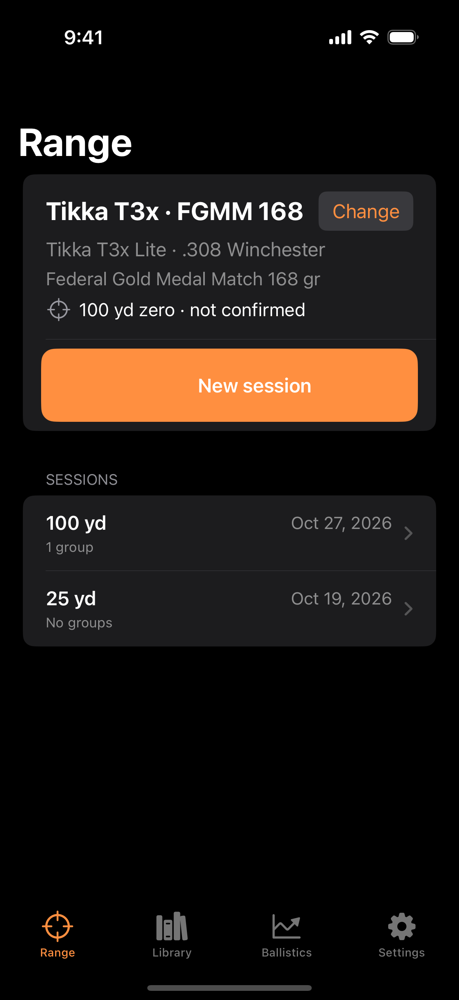
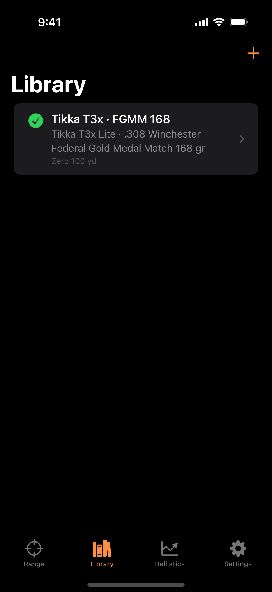
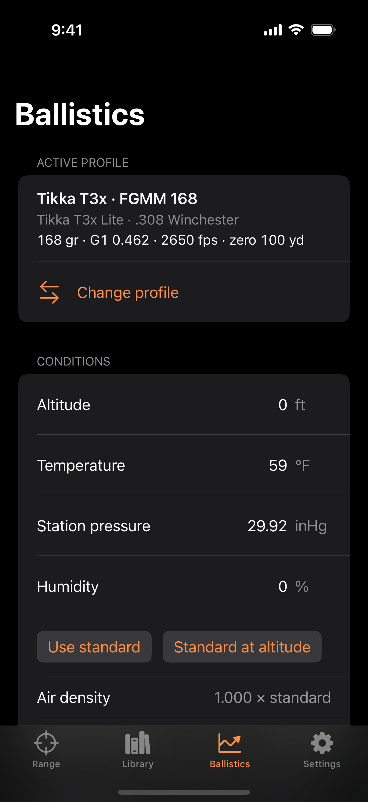
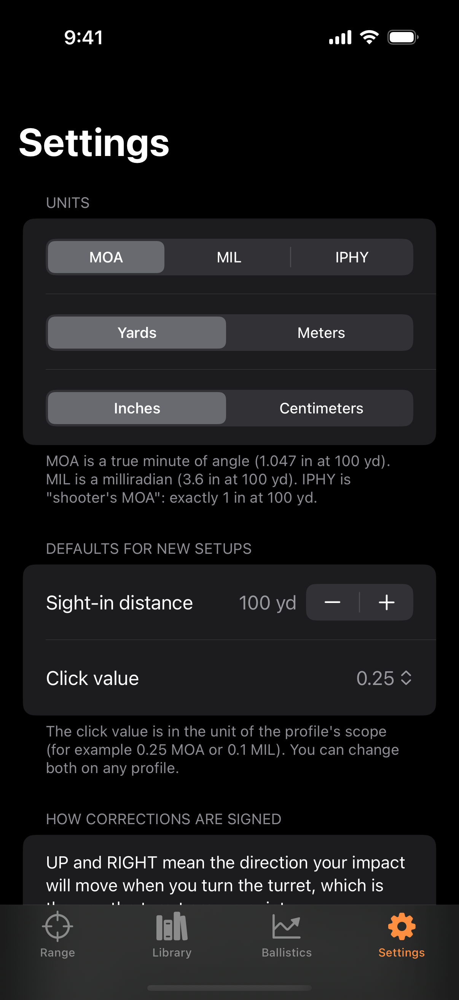
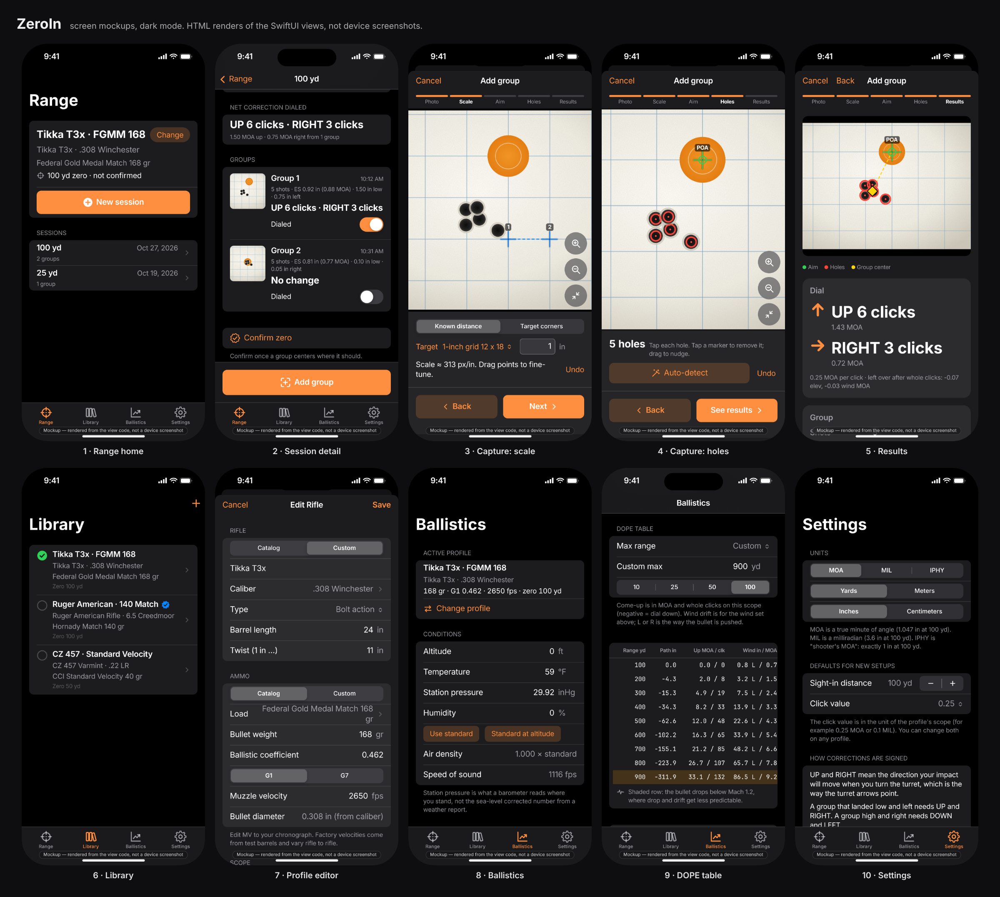

# ZeroIn

Sight in a rifle with your phone. **Shoot a group → photograph the target → get the click correction.**

ZeroIn is an iOS 17 app (SwiftUI + SwiftData, no third-party dependencies) for shooters and hunters. You pick the
rifle and load you are shooting, fire a group at a target, and photograph it. ZeroIn measures where the holes are,
works out how far the group sits from where the bullets *should* have landed, and tells you what to dial:
"UP 6 clicks, RIGHT 3 clicks". A ballistics calculator on the same load gives you drop, wind and come-up for the
rest of the day (DOPE table, range card).

Nothing leaves the device. There are no accounts, no ads and no network calls.

## Screens

- **Range** — the sight-in flow: choose the profile and the distance you are shooting at, take or pick a photo of
  the target, calibrate it (a known length on the target, or the four corners of a sheet of known size), tap the
  point of aim, tap the holes (Vision suggests them; you confirm), then review the group size and the correction.
  Save the group to the session and mark the correction as applied once you have dialed it.
- **Library** — your rifle profiles: firearm, load (bullet weight, ballistic coefficient, muzzle velocity), scope
  (click value, sight height) and zero range. Start from the bundled catalog of firearms and factory ammunition
  or enter everything by hand. Edit, duplicate, delete, and pick the active profile.
- **Ballistics** — for the active profile: atmosphere, wind and slope inputs; launch angle; where the bullet prints
  at 25 / 50 / 100 / 200 yd for your zero; max point-blank range for a 4 to 10 in vital zone; a DOPE table (path,
  come-up in MOA/MIL and clicks, wind drift, velocity, energy, time) with a highlighted transonic row; and a
  plain-text range card you can share.
- **Settings** — angular unit (MOA, MIL, IPHY), distance (yards or meters), linear unit (inches or cm), the
  default sight-in distance and default click value for new setups, and a reminder of how corrections are signed.

## Screenshots

Simulator captures from CI (iPhone 16 Pro, Xcode 16.4), launched with `-seedDemo -uiTab <tab>`:

| Range | Library | Ballistics | Settings |
|---|---|---|---|
|  |  |  |  |

The `ZeroIn iOS` workflow refreshes these on every push that touches `zero-in/`
(see [`.github/workflows/zeroin-ios.yml`](../.github/workflows/zeroin-ios.yml)).

The sight-in capture flow needs a camera and a target photo, so it is not captured in CI. The contact sheet below
is a **mockup** of the whole app rendered from the SwiftUI view code with real solver output (Tikka T3x, .308 Win,
Federal Gold Medal Match 168 gr, 100 yd zero); the individual mockup frames are in
[`docs/screenshots/`](docs/screenshots/).



## The sight-in flow

1. Pick (or create) a profile in **Library**. Check its zero range, click value and sight height.
2. In **Range**, start a session at your shooting distance. Shooting a 100 yd zero at 25 yd is fine: ZeroIn knows
   the bullet may print a little high or low at 25 yd and corrects toward that point, not toward the bullseye
   (`SPEC.md` "Sighting in at another distance").
3. Fire a group (3 to 5 shots is plenty). Photograph the target square-on if you can; the four-corner calibration
   corrects an off-angle photo.
4. Calibrate, mark the point of aim, mark the holes. The review screen shows group size (extreme spread and mean
   radius in inches and MOA/MIL), the group center, and the correction.
5. Dial the correction, shoot another group, repeat until the group is centered. Then **confirm your zero on
   paper**; a calculator is a starting point.

## How corrections are signed

**UP** and **RIGHT** mean the direction your *impact* moves when you turn the turret, which is the way the turret
arrows point. A group that landed low and left needs **UP** and **RIGHT**. Internally `Correction` uses
+elevation = UP and +windage = RIGHT; target space is inches from the point of aim with +x to the shooter's right
and +y up. Trajectory path is negative below the line of sight, and wind drift is positive to the right (a wind
from 3 o'clock gives negative drift).

## Build and run

> **Build status (v0.1):** builds and runs on the iOS 18 simulator under Xcode 16.4 via the `ZeroIn iOS` GitHub
> Actions workflow, which also runs the 70 `ZeroInCore` unit tests. It has not yet been run on a physical
> iPhone, so the camera path of the sight-in flow is untested on hardware. The ballistics math was verified
> numerically through its Python mirror (`tools/ballistics_reference.py`) against py-ballisticcalc, and the
> catalog JSON through `tools/validate_catalog.py`.

Requirements: Xcode 16 or later, an iPhone running iOS 17 or later (the camera is needed for the sight-in flow, so
run on a device; the simulator can still pick photos).

1. Open `zero-in/ZeroIn.xcodeproj` in Xcode 16.
2. Select the **ZeroIn** target, then Signing & Capabilities, and choose your own team.
3. Pick your iPhone and press Run.

The committed project uses Xcode 16 synchronized folders: add a Swift file anywhere under `ZeroIn/` and it is
part of the app with no project edits. If the committed project does not open (it is hand-written and the layout
may differ on your Xcode), regenerate it from `project.yml`:

```bash
brew install xcodegen
cd zero-in && xcodegen generate
```

### Tests

The math lives in the `ZeroInCore` Swift package, which has no UIKit/SwiftUI and runs on macOS and Linux:

```bash
cd zero-in/ZeroInCore && swift test
```

`tools/ballistics_reference.py` is the Python reference the solver is checked against, and
`tools/validate_catalog.py` checks the bundled catalog JSON.

## Data disclaimer

Catalog ballistic coefficients and muzzle velocities are manufacturer-published or typical values. Real loads vary
with barrel length, lot and temperature. Verify them against the box and your own chronograph, and **always
confirm your zero on paper**. ZeroIn is a sighting-in aid, not a substitute for safe handling, a safe backstop or
your own judgment; it gives no guarantee of accuracy or fitness for hunting.

## Architecture

Two pieces:

- **`ZeroInCore`** (Swift package, iOS 17 / macOS 14, no dependencies): units and angular conversions, scope and
  correction types, the 3-DOF point-mass ballistic solver (G1/G7), group statistics, target calibration
  (two-point and four-corner homography), and the catalog types. Pure value types, fully unit-tested.
- **`ZeroIn`** (the app): SwiftUI screens, SwiftData persistence, camera and Vision glue.

```
zero-in/
  project.yml              XcodeGen spec (source of truth for the project)
  ZeroIn.xcodeproj/        committed Xcode 16 project (synchronized folder)
  ZeroInCore/              Swift package: units, ballistics, group analysis, catalog types
    Sources/ZeroInCore/{Units,Ballistics,GroupAnalysis,Catalog}
    Tests/ZeroInCoreTests
  ZeroIn/
    App/                   ZeroInApp, RootView (tabs), AppSettings + UnitsFormatter
    Features/Range/        photo capture, calibration, hole marking, review
    Features/Library/      profiles, catalog pickers, ProfilePicker
    Features/Ballistics/   conditions, zero info, DOPE table, range card
    Features/Settings/     units and defaults
    Persistence/           SwiftData models, CatalogStore, TargetImageStore
    Resources/Catalog/     calibers, firearms, ammo, targets (JSON)
    Assets.xcassets/       AppIcon (placeholder), AccentColor
  docs/CONTRACTS.md        the module API agreement the parallel workstreams built against
  tools/                   Python reference solver, catalog validator
```

User preferences are `@AppStorage` keys defined in `ZeroIn/App/AppSettings.swift`; the active profile is the UUID
string in `activeProfileID`. Product spec and the math: `SPEC.md`.
